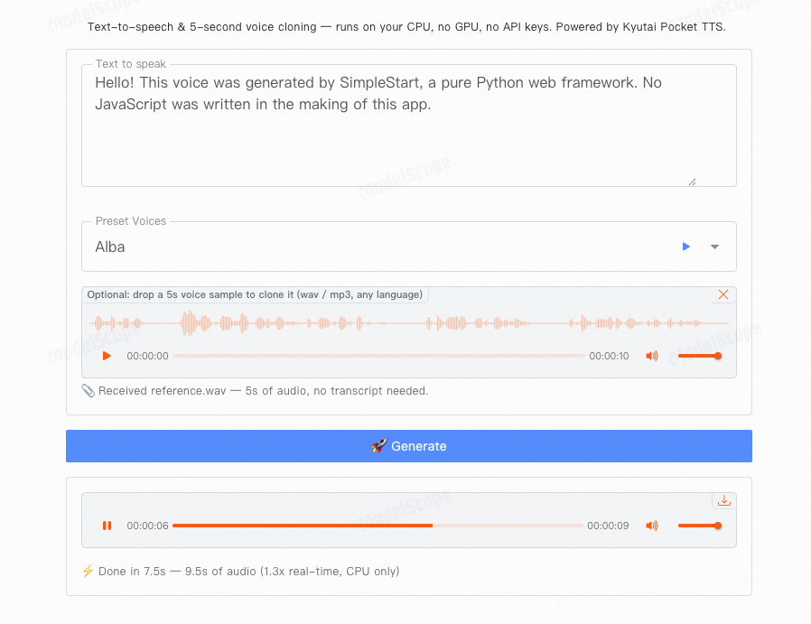

# 🎙️ pocket-tts-simplestart

[English](README.md) | [中文](README.zh-CN.md)

Text-to-speech **and 5-second voice cloning** — 96 lines of pure Python. Runs entirely on CPU, no GPU, no API keys, no JavaScript.

Built with [SimpleStart](https://pypi.org/project/simplestart/) (UI + interaction) and [Kyutai Pocket TTS](https://github.com/kyutai-labs/pocket-tts) (voice synthesis, MIT license).

> ⚠️ Not affiliated with Kyutai Labs. Pocket TTS is their project. Please only clone voices you have permission to use.



> Live demo: [ModelScope Studio](https://modelscope.cn/studios/simplestart/PocketTTS_SimpleStart_Demo)

## ✨ Features

- **5-second zero-shot cloning** — drop any audio clip, no transcript needed, any language
- **9 built-in voices** with instant preview
- **CPU-only inference** — ~2-3x real-time on a laptop, shows per-generation speed badge
- **Background generation** — page stays responsive while synthesizing
- **96 lines** — the whole app is [app.py](app.py), zero front-end code

## 🚀 Quickstart

```bash
pip install -r requirements.txt
ss app.py            # simplestart app.py also works (both aliases point to the same CLI)
```

First launch auto-downloads ~200MB model weights (ModelScope mirror by default, anonymous; falls back to Hugging Face). Open `http://localhost:8000` in your browser.

## 🧬 How voice cloning works

Pocket TTS is zero-shot: it captures timbre, accent, cadence and microphone character from a 5-second reference clip — no fine-tuning, no transcript. The app passes a single `voice` parameter (either a built-in voice name, or a wav file path); everything else goes through the same API.

## 📦 What's included

```
app.py                  # the whole app (96 lines)
modelscope_patch.py     # redirects weight downloads to ModelScope (no token)
assets/voice_samples/   # 9 built-in voice previews
assets/images/          # screenshot used above
requirements.txt
LICENSE
```

## 🙏 Credits

- TTS engine: [Kyutai Pocket TTS](https://github.com/kyutai-labs/pocket-tts) (MIT)
- Voice samples: [kyutai/tts-voices](https://huggingface.co/kyutai/tts-voices) — LibriVox/voice-zero (CC0), VCTK (CC BY 4.0), Alba MacKenna (CC BY 4.0)

## 🔗 Related

- [SimpleStart](https://github.com/readever/simplestart) — the framework this app is built with
- [SimpleStart documentation](https://www.simplestart.cc/) — English docs; Chinese version at [/zh](https://www.simplestart.cc/zh)

## 📄 License

MIT — see [LICENSE](LICENSE).
